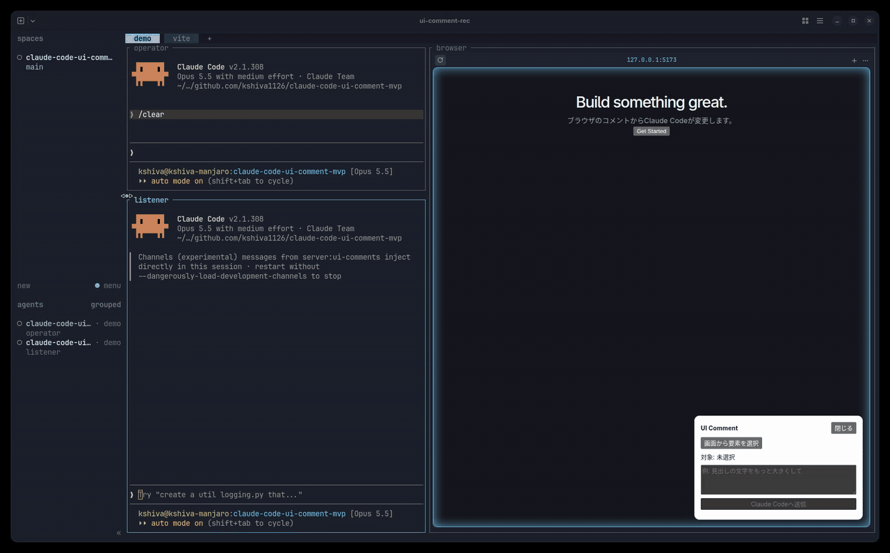

# claude-code-ui-comment-mvp

ブラウザで画面の要素を選んでコメントすると、起動中の Claude Code が変更案を返し、承認した案だけを編集する MVP。



デモの画面構成は次のとおり。

- 左上の operator（Claude Code）: 右の terminal-browser を操作してコメントを送る。
- 左下の listener（Channel 付きの Claude Code）: 提案と編集を行う。

## 仕組み

1. ブラウザから `POST /api/comments` でコメントを送る（Vite の proxy 経由で `127.0.0.1:8788`）。
2. `channel/server.ts` が Claude Code Channels でセッションに通知する。
3. Claude Code は編集せずに `propose_changes` ツールで変更案を返す。案は SSE でブラウザに表示される。
4. ブラウザで案を承認すると、Claude Code がその案だけを編集し、`report_status` で完了を返す。
5. Vite HMR で表示が更新される。

詳細な設計は [claude-code-ui-comment-mvp.md](claude-code-ui-comment-mvp.md) を参照。

## 起動

前提: Claude Pro / Max でログイン済みの Claude Code、Bun、Node.js。

```bash
npm install
npm run dev                                                         # ターミナル A
claude --dangerously-load-development-channels server:ui-comments   # ターミナル B
```

`http://127.0.0.1:5173` を開く（`localhost` だと Origin 不一致で 403 になる）。

## 制約

- ローカル専用。Channels は Research Preview のため、今後仕様の変わる可能性がある。
- コメントと提案はメモリにだけ保持する。Claude Code を終了すると消える。
- `channel/server.ts` を変更したら Claude Code の再起動が必要。

## 保守者

[@kshiva1126](https://github.com/kshiva1126)
